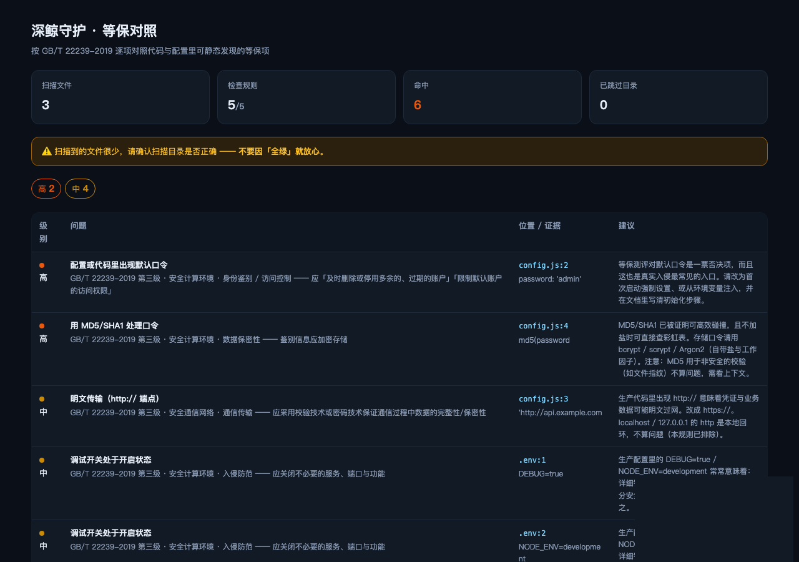

# @deepwhale-cn/dsh-cn-mlps

[](https://dsh-plugin.org/plugins/feely0208/dsh-cn-mlps)

**等保对照** —— 按 GB/T 22239-2019，把代码和配置里**可静态发现**的等保项找出来。

## 先说清楚它是什么、不是什么

**它不能替代等保测评。**

等保的绝大部分要求针对**已部署的系统与运维过程** —— 物理环境、边界设备、安全管理中心、
制度、人员。**代码扫描看不到这些。**

它只做一件事：**把「测评前开发者自己能改掉」的问题找出来。**
测评时被指出的一堆问题，其实上线前就能修 —— 这个检查就是干这个的。

## 它查什么

| 级别 | 内容 | 依据（章节名）|
|---|---|---|
| 🔴 高 | 默认口令 | 安全计算环境 · 身份鉴别 / 访问控制 |
| 🔴 高 | MD5/SHA1 存口令 | 安全计算环境 · 数据保密性 |
| 🟡 中 | http:// 明文传输 | 安全通信网络 · 通信传输 |
| 🟡 中 | 调试开关残留 | 安全计算环境 · 入侵防范 |
| 🟡 中 | 错误信息泄露内部细节 | 安全计算环境 · 入侵防范 |

## 为什么 source 只写章节名

**因为条款编号我无法逐条核实，编了就是假判据。**

「安全计算环境 · 身份鉴别」这类**章节名**是确定的，你拿着标准原文就能对上。
写一个核不准的 `8.x.4.y` 反而是误导。

**而且这是 CI 卡口**：规则里出现 `数字.数字.数字` 形式的编号，测试直接失败。

## 安装

```bash
dsh plugin --profile web add @deepwhale-cn/dsh-cn-mlps
# 或纯 CLI
npx @deepwhale-cn/dsh-cn-mlps
```

## 用法

```bash
dsh-cn-mlps --demo          # 看检出效果
dsh-cn-mlps --list-rules    # 列出规则和依据
dsh-cn-mlps --html r.html   # HTML 报告
```



## 边界

- ❌ **不能替代等保测评**，不保证通过测评。
- ❌ 不覆盖物理环境 / 区域边界 / 安全管理中心 / 制度 / 人员 / 建设 / 运维管理。
- ❌ **不做缺项判定**：「没扫到问题」≠「该项符合」。
- ⚠️ 锚点是**章节名不是编号**，请以标准原文为准；具体要求随级别不同。
- 日志留存（≥6 个月）在配套插件 [dsh-cn-log-retention](https://github.com/feely0208/dsh-cn-log-retention) 里。

本插件是一个工具。使用者必须遵守所在地区法律法规，**对使用本项目造成的任何后果自行承担责任。**

## License

MIT © 深鲸 DeepWhale
